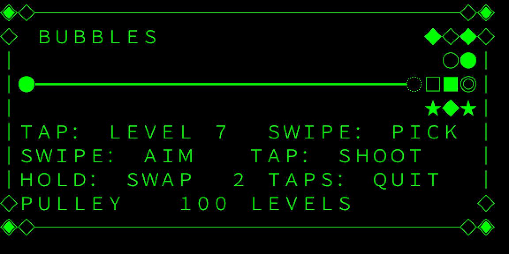
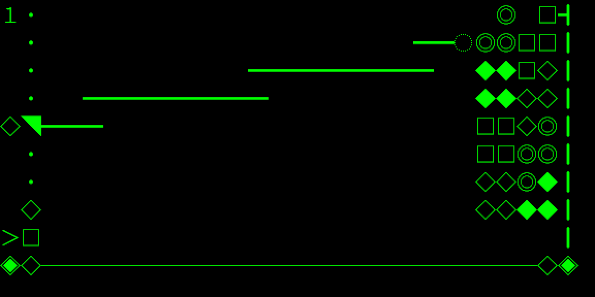
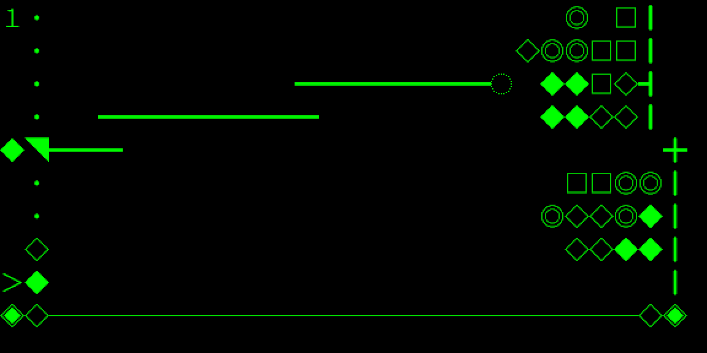
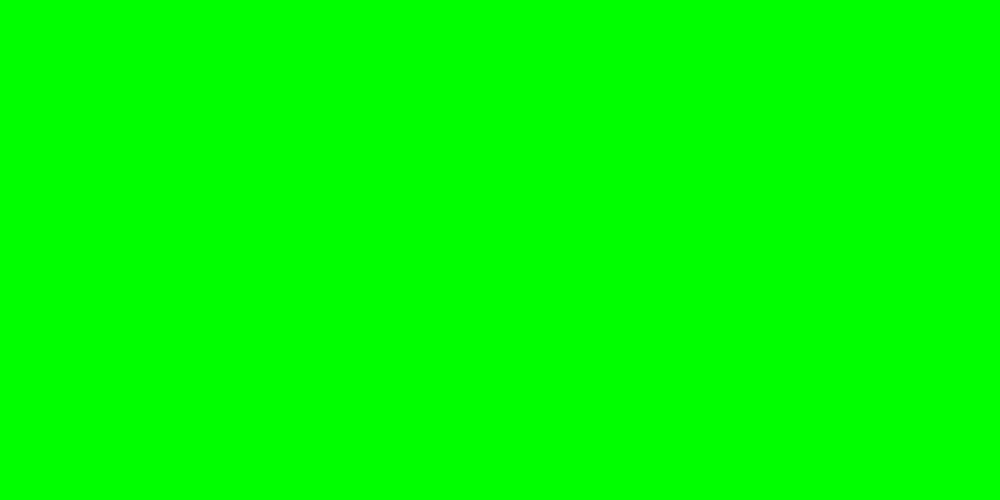
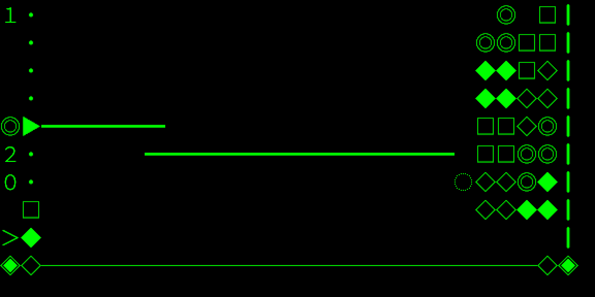
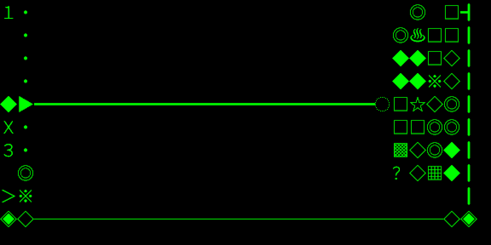
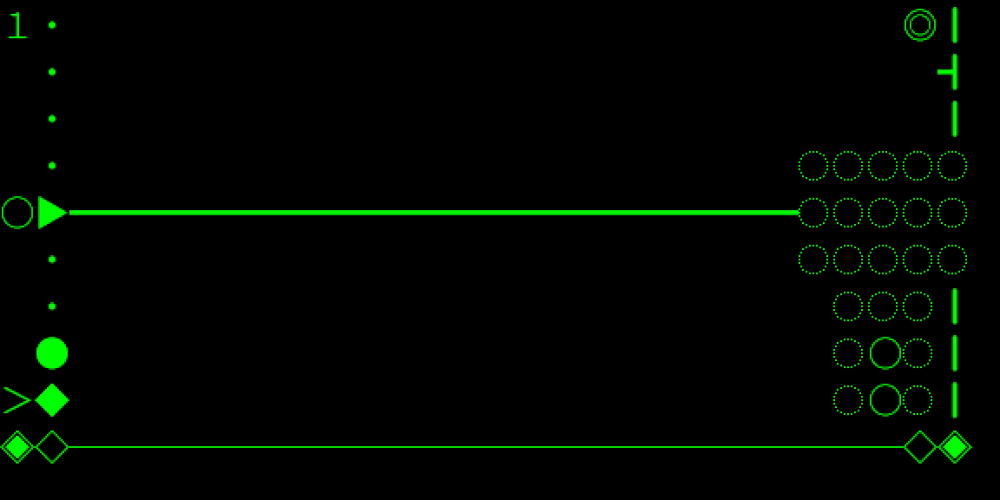
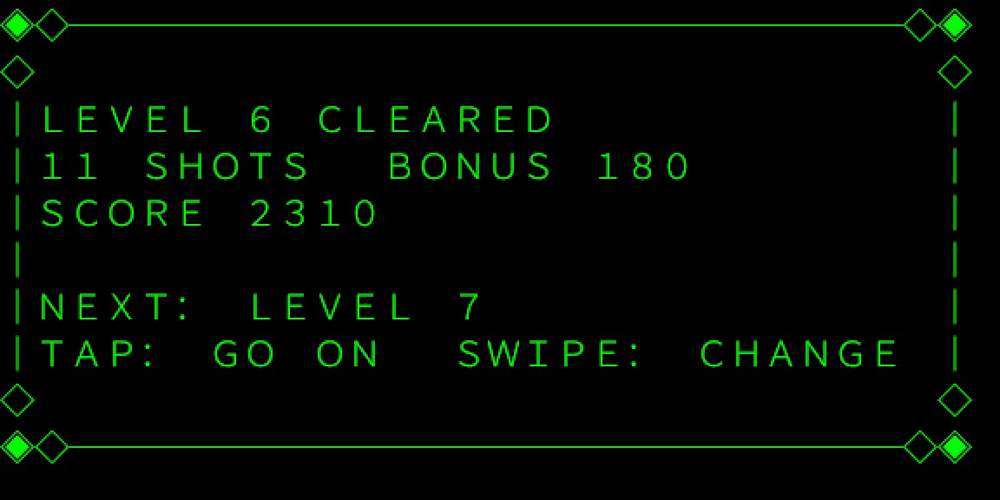
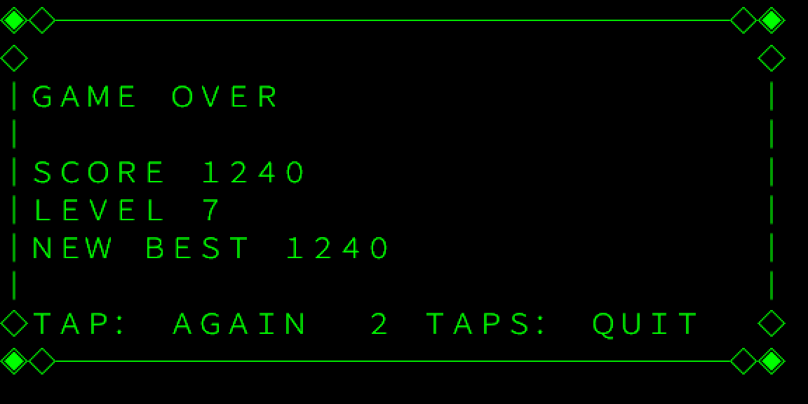

# Bubbles – a sideways bubble shooter for Even G2

A minimal Frozen Bubble / Puzzle Bobble style game for Even Realities G2
glasses. No characters, no art: an aim line, bubbles stacked against the right
edge, and the touchpad.

- **Swipe up or down** to aim, also while a shot is still flying. Each swipe moves the aim to the next cell the bubble could land in, turning by at most 8°, so no reachable spot is skipped. The line shows where the bubble will go, bounces included.
- **Tap** the touchpad or R1 ring to shoot. Three or more of a kind pop; anything left hanging falls. A tap while a shot is still flying queues the next one, fired the moment this one lands; clearing the level cancels it.
- **Hold** the touchpad to swap the loaded bubble with the next one. (Centering the aim moved to the menu; every new game starts centered.)
- **Tap, then hold** to open the G2 contextual menu, where you can restart or center the aim.
- **Double tap** to open the G2 system exit confirmation from any screen.
- **Tap, then hold** also switches mode (classic, pulley, endless, puzzle) and
  toggles the aim guide between full and short (stops at the first bounce).
- **Swipe on the title or game-over screen** to pick the level to start on, up to
  the highest level you have reached. A returning player starts where they got
  to; after a game over, "play again" continues on the same level. Starting
  higher always starts at score 0.

The aim guide ends in a landing marker and stays up while a shot is in
flight, so you can line up the next one straight away: the moment a bubble
leaves, the queued bubble moves into the launcher and the line is its line.
During the flight the prediction is against the board as it stands; it
corrects itself when the shot lands. Clearing a board gets a short level card
before the next layout appears,
and the game-over screen says when you have set a new best.

During play, a dotted line marks the loss zone, the launcher tilts with the
selected angle, and the queued bubble is labeled at bottom left. A tick (┫) moves
down the wall once per shot to show when its eight-shot advance is approaching.
Flying bubbles leave a two-cell trail. Matches animate through sparkle, burst
and ring glyphs, while detached bubbles visibly fall for the same three frames.
The level number stands in fullwidth digits down the top-left corner, in the
column no bubble can ever occupy; score and best live on the phone page and
the end screens.

Scoring: 10 points per bubble popped, and bubbles that fall because a match
detached them pay exponentially, 20 for one, 60 for two, 140 for three and so
on (20 × (2ⁿ − 1), capped at eight), so the shot that cuts a cluster loose is
worth more than the easy match. Clearing a level is 100. The best score only
competes among games started at level 1; a game started higher shows its score
but cannot set a best. A clear of five or more bubbles blasts: an extra effect
frame and a ring of empty cells ripples outward; ten or more gets two rings.

### Special bubbles

From level 3 the layouts carry a few specials, drawn with glyphs the firmware
font has. A star ☆: a shot that lands next to it clears every bubble of the
shot's colour. A rainbow ※ joins any colour, so it bridges matches; the odd
shot is a rainbow too, and it takes whichever neighbouring colour pops most.
A bomb ♨ (from level 4): a shot landing beside it blows away everything
around it, and any bomb caught in the blast goes off too. Ice ▦ (from level
5): a pop beside it cracks it to ▤, a second pop frees it. A stone ▩ (from
level 6) never pops and only falls when nothing holds it. Mystery bubbles ？
are ordinary colours hidden until a shot lands or a pop happens beside them.

### Pickups and the second chance

From level 2 a ＋ sometimes appears in the open part of the field. A shot that
flies through it loads a special as the next bubble: a rainbow, a bomb that
goes off where it lands, or a star that clears the colour it lands against.
Aim for the pickup on the way to the target. One pickup is out at a time.

Once per game, a game over offers a continue: tap, and the three columns
nearest the shooter are cleared (puzzle mode also gets five shots back) and
play goes on. The run no longer counts for the best score; the best was
recorded at the moment you first went down.

### Scoring extras

Consecutive shots that remove something build a combo: the second pays
double, the third triple, up to five times, shown as Ｘ２ … Ｘ５ under the
launcher. A shot that removes nothing resets it. The bubble after next is
shown above the next one. Each mode keeps its own best score.

### Pulley mode

The Bust-A-Move 4 idea: two groups hang from one axle (╋ on the shooter row),
the rows above it and the rows below, each on its own wall. The group with
more bubbles hangs closer to you, one column per four bubbles of difference,
up to four. Pop on one side and the other side swings in; anything a shift
tears loose falls. Levels are the same 100 layouts with the axle row left
clear. Pulley is the default; switch to classic from the G2 menu, the phone
page, or `?mode=classic`. The choice is remembered.

### Endless and puzzle modes

Endless: a random board five columns deep, and every six shots a fresh column
pushes in from the wall (with the odd gap and, from wave 2, specials). The
wall never moves; the pushes are the pressure, and the hurry-up pushes a
column instead of moving the wall. Waves count up in the HUD; the palette
widens every three waves. Clearing the board pays the level bonus and deals a
new one.

Puzzle: the same 100 layouts with a shot limit, half the level's bubbles plus
five, counted down under the launcher. No wall advance and no hurry-up: run
out of shots with bubbles left and the game is over.

### Difficulty, levels beyond 100, and stats

Difficulty (phone page or the G2 menu): easy moves the wall every 10 shots
and never hurries you; normal every 8 with the hurry-up; hard every 6 with a
faster hurry-up. Puzzle mode gets 8, 5 or 3 spare shots. In endless, waves
start every 7, 6 or 5 shots and come one shot sooner every eight waves, down
to three, with the hurry-up tightening to match.

Clearing level 100 is still the ending, but it unlocks level 101 onward:
generated layouts in the same shape, seeded by the level number so level 137
is the same for everyone, denser and more colourful the further you go, up to
999. Pick any level you have reached from the phone page's level field, or by
swiping on the title.

The phone page keeps lifetime totals: games, shots, bubbles popped and
dropped, biggest drop, longest combo, levels cleared, pickups taken and the
furthest wave. They live in the Even app's local storage with the scores.

### Pace

The wall blinks on the last shot before it advances. It also hurries you:
after about 11 seconds without a shot it blinks, and at 15 it advances by
itself. Each level opens with READY and GO over the layout, during which
input is ignored. A clear pays a bonus for every shot under par (half the
level's bubbles) and shows a level card until you tap; swipe up on it to
take the harder path and skip the next level for 200 points.

Every 8 shots the wall moves one column closer. A bubble settling in the two
leftmost columns ends the game. Clear the field to move on to the next of
the 100 levels.

## Screenshots

Captured from the Even Hub simulator, which uses the glasses' own font. The
glasses show them in green on black at 576 × 288; these are doubled.

| | |
|---|---|
|  Title |  Aiming in classic mode |
|  A shot in flight |  Pulley mode |
|  Endless mode, wave 2 |  Puzzle mode, shots left under the launcher |
|  Special bubbles and a combo |  A five-bubble clear blasting |
|  Level card |  Game over |

## Privacy

The app collects nothing and makes no network requests; it stores your best
scores, level reached and two settings through the Even app's local storage on
your phone. See `PRIVACY.md`.

## Source and licence

The code lives at https://github.com/reseed-ops/bubbles-even-g2. The whole
project is GPL-2.0 because the level data is Frozen Bubble's (below); `LICENSE`
is the full text. Issues and pull requests are welcome there.

## Levels

The layouts are the 100 original Frozen Bubble levels (`levels/`), rotated
so the ceiling becomes the right-hand wall. Frozen Bubble uses a hex grid;
the half-cell offset of every other row is snapped onto the square text
grid, and bubbles count as touching on all eight sides, so every contact in
the original designs is preserved. `node scripts/convert-levels.mjs`
regenerates `src/levels.ts` from the level file.

The level data is GPL-2.0 (see `LICENSE` and `levels/README.md`), which
makes this project GPL-2.0 as a whole.

## How it is drawn

The app uses one native 576 × 288 text container for its whole lifetime. The
title, gameplay, level-clear card and game-over screen all update that same
container with `textContainerUpgrade`, avoiding page rebuilds and large image
transfers over BLE.

The playfield is a 28 × 9 grid of fullwidth characters. An ideographic space
keeps empty cells aligned in the proportional system font. The eight bubble
types are ● ○ ◎ ◆ ◇ ■ □ ★. The aim guide is drawn with ━, ／, ＼ or ┃
chosen from the aim angle (flat below 12°, upright above 58°, a slash in
between, flipping at each bounce), so a diagonal aim reads as one continuous
line; ◌ marks the predicted landing cell and the wall is ┃. These effects are
still characters in the same container—there are no image transfers.

The display fits ten rows of the grid. The playfield uses nine and the tenth
carries the frame's floor: an ornate rule with ◈ corners and ◇ flourishes.
The title, level card and game-over screens are fully framed (◈◇ corners,
light ─ and │ edges so the frame sits back from the heavy ━ aim line, a ◇
flourish at the top and bottom of each side) and set
entirely in fullwidth capitals, which the firmware font has at exactly one
cell, so every row of every screen is a grid row. `fullwidth()` in
`src/grid.ts` converts ASCII to those forms. The grid is
only regenerated when gameplay or aim state changes. Updates that arrive while
a previous BLE write is still in flight are dropped; the next tick sends the
newest state instead of building a stale frame queue. Every update sends the
whole screen: `contentOffset`/`contentLength` on a text upgrade are not a
splice, and the simulator shows only the text sent, drawn from the top, so a
changed-span update leaves the rest of the display blank.

The app does not start the IMU sensor. Aim is controlled entirely by swipe
events, eliminating calibration drift and saving the work of a continuous
sensor stream.

The G2 OS contextual menu exposes **Restart game** and **Center aim** on every
screen. While that overlay is open the game loop pauses, then repaints when it
closes. This follows the SDK 0.0.14+ overlay lifecycle and keeps the root-page
double-tap reserved for the required system exit dialog.

## Project layout

| File | Purpose |
|---|---|
| `src/layout.ts` | Grid size, speeds, limits. Tune the game here. |
| `src/game.ts` | Pure game logic: field, shooting, landing, popping, dropping, levels. |
| `src/grid.ts` | Pure rendering of game state to the text the glasses show. |
| `src/levels.ts` | Generated: the 100 Frozen Bubble levels on this grid. |
| `scripts/convert-levels.mjs` | Regenerates `src/levels.ts` from `levels/frozen-bubble-levels.txt`. |
| `scripts/run.sh`, `scripts/dev-env.sh` | Find or create the Linux-side build directory and run the toolchain there. |
| `scripts/simulator.sh` | Headless simulator with the automation API. |
| `src/events.ts` | Normalises glasses, ring and simulator events into inputs. |
| `src/renderer.ts` | The persistent full-screen text page and text pushes over the bridge. |
| `src/app.ts` | Game loop, input handling and high-score persistence. |
| `src/main.ts`, `index.html` | The phone page: a live mirror of the glasses, status, score and controls. |
| `test/game.test.js` | Logic tests: popping, dropping, aim prediction, all 100 levels, random games. |
| `app.json` | Even Hub manifest. |
| `store-description.txt` | The Even Hub listing text; `evenhub update --description-file` uploads it. |
| `public/icon.png` | 24 × 24 icon drawn in 2 × 2 blocks, as the glasses show it. |

## Running

### If this folder is on Android shared storage

`/sdcard` cannot hold symlinks or run native binaries, so npm cannot
install the toolchain here. Every npm script goes through
`scripts/run.sh`, which runs the command in a build directory on the Linux
filesystem (`~/build/frozen-bubble`, or `BUBBLES_BUILD_DIR`) that links
back to these sources. The first run creates it. So you can simply run the
commands below from this folder; do not run `npm install` here.

### Everyday commands

```sh
npm run dev            # Vite dev server on port 5180, reachable on the LAN
npm run simulate       # Even Hub simulator pointed at the dev server
npm run simulate:headless  # same, on a virtual display with the automation API (see below)
npm run qr             # QR code for the glasses; scan it in the Even app (Developer Mode)
npm test               # game logic tests
npm run build          # type-check and bundle to dist/
npm run pack           # build and produce bubbles.ehpk for Even Hub
```

For the glasses: keep `npm run dev` running, run `npm run qr` in a second
terminal, and scan the code with the Even app's Scan QR button. The phone
and the computer must be on the same network.

### Simulator without a desktop

The simulator is a WebKitGTK app. On Debian it needs:

```sh
apt-get install -y --no-install-recommends libwebkit2gtk-4.1-0 libsoup-3.0-0 libjavascriptcoregtk-4.1-0 xvfb
```

`npm run simulate:headless` runs it on a virtual X display with the
automation API on port 9898, so it can be driven from a shell or a script:

```sh
curl -s http://127.0.0.1:9898/api/screenshot/glasses -o glasses.png
curl -s -X POST -H 'content-type: application/json' -d '{"action":"click"}' http://127.0.0.1:9898/api/input
curl -s http://127.0.0.1:9898/api/console
```

Actions are `up`, `down`, `click`, `double_click`, `long_press`,
`long_press_release`, `context_menu`. It uses the same LVGL font as the firmware, which makes it the
reference for glyph widths.

### The phone page

While the game runs on the glasses, the Even app shows `index.html`. It
mirrors the display in a 2:1 lens: every line of the screen text is one of
nine rows, and a 28-glyph line is laid out as 28 equal cells, so the grid
stays square whatever fonts the phone has. Straight line glyphs (━ ┃ ┫) are
drawn as CSS lines so they join across cells as the firmware font's
box-drawing glyphs do. Under the lens are the connection
state and what the game is doing, level, score, best, exact aim angle and wall
countdown, two buttons
(New game, Center aim) and the gesture guide. The green is reserved for the
lens; the rest of the page is grey.

### Developer URLs

- `?test=font&set=1` to `set=16`: draws rows of candidate glyphs, 27 per row
  plus the wall character. Rows whose wall lines up with the first
  (ideographic space) row are safe grid glyphs. The middle dot `·` is a
  quarter cell wide; the katakana middle dot `・`, the dotted circle, all
  eight bubble glyphs, fullwidth Latin letters and digits, launcher symbols,
  the danger line and effect glyphs are all covered by these tests.
- `?preview=over` or `?preview=won`: shows the game-over screen with sample
  numbers, for checking its layout without playing to the end; `?preview=title`
  shows the title screen as a player who has reached level 7 sees it;
  `?preview=card` shows the level card; `?preview=blast` stages a five-bubble clear, fired by the next tap, to watch
  the blast effect; `?preview=specials` stages a star, a rainbow and a stone
  with a rainbow queued (plus a bomb, ice and a mystery, and a running combo);
  `?mode=classic|pulley|endless|puzzle` picks the mode; `?aim=short` the
  short aim guide; `?level=137` unlocks and picks a start level; `?preview=over` shows the game over with the continue offer.

## Known limits

- Frame rate is bounded by the BLE text-update path. Measured on G2 glasses
  (October 2026), a whole-screen push takes about 156 ms from send to
  acknowledgement and the glasses accept one at a time, so the game displays
  about 6 frames per second. Letting two pushes be in flight made it worse:
  longer round trips, 19% dropped frames, 4.7 frames per second. The default is
  therefore one push at a time, with the loop waiting for each. The phone page
  shows the measured push round trip, the frames per second actually displayed
  while something was moving, the share of frames skipped, and a
  "Glasses updates" switch to try pipelining on other firmware. A "Measure
  push cost" button on the phone page times the current screen, a one-letter
  screen and the title with every empty cell sent as two ASCII spaces (two
  bytes instead of the three of U+3000), to show whether bytes or rendering set
  the push time. It can be run mid-game; the game pauses while it runs.
- Motion is time based. The loop passes the real time elapsed since the last
  tick, in units of `TICK_MS` (100 ms), so a shot covers the same distance per
  second at 6 frames per second as it would at 12. A stall longer than three
  ticks is capped so the shot never teleports.
- A shot stops only on real contact: head-on or directly alongside a bubble, or
  at the wall. Diagonal cells are 1.4 diameters apart, so a shot slides past a
  corner instead of catching on it. Hanging and matching still use all eight
  neighbours, as the hex levels need.
- The font is proportional. Only glyphs measured as one cell wide may go in the grid; see the font test page.
